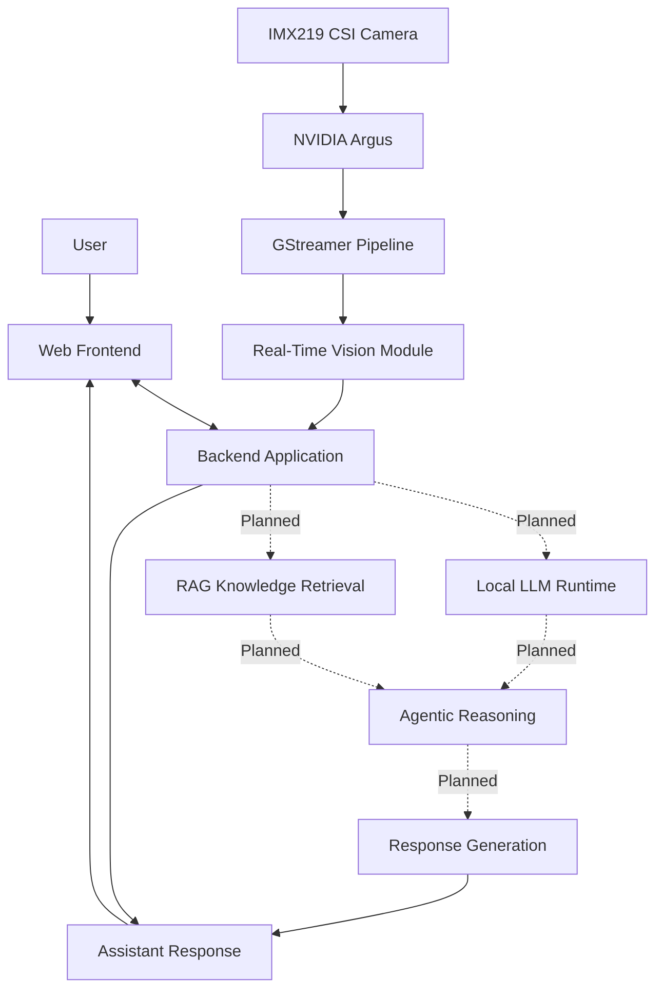

 <div align="center">

# 🧠 Privacy-First Multimodal Edge AI Assistant

### Local Intelligence. Real-Time Vision. Private-by-Design Edge Computing.

**Building an intelligent, multimodal AI assistant directly on NVIDIA Jetson Orin Nano (8GB).**


**Research • Development • Edge Intelligence • Multimodal AI**

</div>

---

## 📌 Table of Contents

1. [Overview](#-overview)
2. [Problem Statement](#-problem-statement)
3. [Project Vision](#-project-vision)
4. [Key Objectives](#-key-objectives)
5. [System Architecture](#-system-architecture)
6. [Hardware Requirements](#-hardware-requirements)
7. [Technology Stack](#-technology-stack)
8. [Repository Structure](#-repository-structure)
9. [Camera Configuration](#-camera-configuration)
10. [Installation and Setup](#-installation-and-setup)
11. [Privacy-First Approach](#-privacy-first-approach)
12. [Performance Evaluation](#-performance-evaluation)
13. [Development Roadmap](#-development-roadmap)
14. [Future Enhancements](#-future-enhancements)
15. [Contributing](#-contributing)
16. [Author](#-author)

---

## 🚀 Overview

The **Privacy-First Multimodal Edge AI Assistant** is an Edge AI research and development project focused on bringing intelligent AI capabilities directly onto compact computing hardware.

The system is being developed using the **NVIDIA Jetson Orin Nano Developer Kit (8GB)**, with the objective of combining real-time visual perception, local language models, knowledge retrieval, and intelligent agent workflows into a unified assistant.

Unlike conventional cloud-dependent AI applications, this project follows a **local-first architecture**, prioritizing on-device computation, reduced network dependency, lower response latency, and user privacy.

The project explores the integration of:

- Real-time computer vision.
- Local Large Language Models (LLMs).
- Multimodal AI interaction.
- Retrieval-Augmented Generation (RAG).
- Agentic reasoning and intelligent workflows.
- Edge inference optimization.
- Privacy-preserving AI processing.

The ultimate goal is to develop a capable AI assistant that can understand its environment, process information, and assist users while operating primarily on local hardware.

## 🎯 Problem Statement

Most modern AI assistants depend heavily on cloud infrastructure for visual understanding, language processing, and intelligent decision-making.

This creates several challenges:

- **Privacy concerns:** Sensitive user information and camera data may be transmitted to external servers.
- **Internet dependency:** Many AI capabilities become unavailable without network connectivity.
- **Latency:** Cloud communication introduces additional response delays.
- **Infrastructure cost:** Continuous cloud inference can increase operational expenses.
- **Limited edge intelligence:** Running multiple AI workloads on resource-constrained devices requires careful optimization.

### Proposed Solution

Develop a privacy-first multimodal AI assistant that performs as much perception and intelligence processing as practical directly on NVIDIA Jetson Orin Nano.

The architecture aims to combine local vision processing, language intelligence, knowledge retrieval, and controlled agent workflows into one modular system.

## 💡 Project Vision

To build a compact, intelligent, and privacy-conscious AI assistant that can:

- See and interpret its surroundings through a camera.
- Understand user requests.
- Process information using locally hosted AI models.
- Retrieve relevant information from a knowledge base.
- Perform structured multi-step reasoning.
- Deliver useful responses through an integrated interface.
- Operate with minimal dependence on external cloud services.

## 🎯 Key Objectives

| Objective | Description |
|---|---|
| Edge AI Deployment | Execute AI workloads directly on Jetson hardware |
| Real-Time Vision | Capture and process live camera frames |
| Local Intelligence | Integrate locally hosted language models |
| Multimodal Processing | Combine visual and textual information |
| RAG Integration | Ground responses using relevant knowledge |
| Agentic Workflows | Explore controlled tool usage and task execution |
| Privacy | Minimize unnecessary external data transmission |
| Optimization | Evaluate inference speed and hardware utilization |

## 🏗️ System Architecture

The following diagram illustrates the intended high-level architecture. Components marked as planned are integration targets, not claims of completed functionality.



### Architecture Components

**1. User Interface**

Provides the interaction layer through which users communicate with the assistant.

**2. Backend Application**

Acts as the central application layer, connecting the interface with processing modules.

**3. Vision Processing**

Uses the CSI camera and NVIDIA Argus/GStreamer pipeline to capture and process visual input.

**4. Local LLM Runtime — Integration Target**

Intended to provide locally hosted language intelligence without requiring every request to be sent to an external service.

**5. Retrieval-Augmented Generation — Integration Target**

Intended to retrieve relevant information from a knowledge base before generating grounded responses.

**6. Agentic Reasoning — Integration Target**

Intended to coordinate multi-step tasks and controlled tool execution.

## 🖥️ Hardware Requirements

### Primary Hardware

| Component | Specification |
|---|---|
| Edge Device | NVIDIA Jetson Orin Nano Developer Kit |
| RAM | 8GB |
| Camera | Arducam 8MP Sony IMX219 |
| Interface | CSI Camera Interface |
| Camera Software | NVIDIA Argus + GStreamer |
| Storage | MicroSD / NVMe storage |

### Development Environment

| Component | Version |
|---|---|
| JetPack | 7.2 |
| Jetson Linux | R39.2 |
| Linux Kernel | 6.8.12-tegra series |
| CUDA | 13.2 |
| TensorRT | 10.16 |
| OpenCV | System build with GStreamer support |

*These are the environment versions recorded during development. Exact versions should be verified on the target device.*

## 🧰 Technology Stack

| Category | Technologies |
|---|---|
| Programming | Python |
| Edge Platform | NVIDIA Jetson Orin Nano |
| Computer Vision | OpenCV |
| Camera Pipeline | NVIDIA Argus, GStreamer |
| Frontend | HTML |
| Backend | Python |
| AI Inference | Local model runtimes (integration target) |
| Knowledge Retrieval | RAG (planned integration) |
| Agent Workflows | Agentic AI (planned integration) |

## 📂 Repository Structure

```text
Privacy-First-Multimodal-Edge-AI-Assistant/
│
├── backend/
│   └── main.py
│
├── frontend/
│   └── index.html
│
├── vision/
│   └── live_detector.py
│
├── config/
│
├── docs/
│
├── logs/
│   └── .gitkeep
│
├── assets/
│   └── logo.svg
│
├── bus.jpg
│
├── .gitignore
│
└── README.md
```

*The structure reflects the initial repository source upload. Additional modules will be documented as they are added.*

## 📷 Camera Configuration

The project uses an **Arducam 8MP Sony IMX219 CSI camera** connected to the Jetson Orin Nano.

The camera pipeline uses NVIDIA Argus and GStreamer to capture frames and convert them into a format suitable for OpenCV processing.

### Camera Processing Pipeline

```text
IMX219 CSI Camera
       |
       v
NVIDIA Argus
       |
       v
GStreamer Pipeline
       |
       v
NVMM / NV12
       |
       v
nvvidconv
       |
       v
BGRx Conversion
       |
       v
OpenCV Video Capture
       |
       v
Vision Processing
```

### Test Camera Preview

Run this command on the Jetson terminal:

```bash
gst-launch-1.0 nvarguscamerasrc sensor-id=0 ! \
'video/x-raw(memory:NVMM),width=1280,height=720,format=NV12,framerate=30/1' ! \
nvvidconv ! nvegltransform ! nveglglessink -e
```

This command tests the standalone NVIDIA camera pipeline. Application-level OpenCV and model integration should be validated separately.

### Troubleshooting

Check whether the sensor is detected:

```bash
dmesg | grep -i imx219
```

Check whether the NVIDIA camera source is available:

```bash
gst-inspect-1.0 nvarguscamerasrc
```

If the preview works but the Python application cannot open the camera, verify the OpenCV GStreamer support and the pipeline configuration.

## ⚙️ Installation and Setup

### Step 1: Clone the Repository

```bash
git clone <YOUR_REPOSITORY_URL>
cd <REPOSITORY_DIRECTORY>
```

### Step 2: Check the Jetson Environment

```bash
uname -a
cat /etc/nv_tegra_release
nvcc --version
```

### Step 3: Create a Python Environment

```bash
python3 -m venv .venv
source .venv/bin/activate
```

Upgrade pip:

```bash
python -m pip install --upgrade pip
```

### Step 4: Install Dependencies

Install the dependencies required by the actual application modules and the installed JetPack version.

**Important:** A verified `requirements.txt` has not yet been included in the initial repository snapshot. Jetson-specific AI libraries should be installed using compatible NVIDIA-supported builds.

### Step 5: Run the Application

Inspect `backend/main.py` for the actual application entry point and start the backend using its defined launch command.

The frontend is located at:

```text
frontend/index.html
```

The exact application launch command and port should be documented after validating the current backend implementation.

## 🔐 Privacy-First Approach

Privacy is one of the central design principles of this project.

The system aims to follow these principles:

- **Local Processing:** Prefer on-device inference for sensitive workloads.
- **Reduced Cloud Dependency:** Avoid unnecessary external API calls.
- **Data Minimization:** Avoid retaining raw camera data unless a feature requires it.
- **Secure Configuration:** Keep API keys and credentials outside source control.
- **Transparent Processing:** Clearly distinguish local processing from cloud-based operations.

The privacy-first objective will be evaluated through implementation and testing as the system develops.

## 📊 Performance Evaluation

The system is intended to be evaluated directly on NVIDIA Jetson Orin Nano.

Important performance metrics include:

| Metric | Purpose |
|---|---|
| FPS | Measures real-time vision throughput |
| Inference Latency | Measures model processing time |
| End-to-End Latency | Measures total response time |
| RAM Usage | Measures memory consumption |
| GPU Utilization | Measures GPU workload |
| Power Consumption | Evaluates energy efficiency |
| Temperature | Monitors sustained hardware operation |

Benchmark results will be published after controlled end-to-end testing.

No unverified performance figures are presented as measured results.

## 🛣️ Development Roadmap

- [x] Establish the project repository.
- [x] Organize the initial backend, frontend, and vision source files.
- [x] Configure the IMX219 CSI camera.
- [x] Configure the NVIDIA Argus/GStreamer camera pipeline.
- [x] Update the vision module for CSI camera input.
- [ ] Validate OpenCV camera capture inside the complete application.
- [ ] Add a verified dependency manifest.
- [ ] Complete local LLM runtime integration.
- [ ] Implement and evaluate RAG.
- [ ] Implement controlled agentic workflows.
- [ ] Add comprehensive testing and error handling.
- [ ] Perform end-to-end performance benchmarking.
- [ ] Publish real screenshots and demonstration videos.

## 🚀 Future Enhancements

Potential future improvements include:

- Fully offline multimodal interaction.
- Optimized local LLM inference.
- Real-time visual question answering.
- Local document and knowledge retrieval.
- Intelligent tool execution.
- Voice-based interaction.
- Model optimization using TensorRT.
- Performance-aware workload scheduling.
- Improved security and privacy auditing.

These are development directions and should not be interpreted as completed features.

## 🤝 Contributing

Contributions and technical suggestions are welcome.

1. Fork the repository.
2. Create a feature branch.
3. Implement and test your changes.
4. Commit with a descriptive message.
5. Submit a pull request.

```bash
git checkout -b feature/your-feature
git add .
git commit -m "Add: describe your feature"
git push origin feature/your-feature
```

For hardware-specific changes, include the JetPack version and device configuration used during testing.

## 📄 License

A license has not yet been selected for this repository. Until a `LICENSE` file is added, reuse and redistribution permissions are not explicitly granted.

## 👨‍💻 Author

**Samarth Kale**

B.Tech Computer Science Engineering  
MIT ADT University, Pune  
Specialization: Artificial Intelligence in Edge Computing

GitHub: [@SamarthKale5556](https://github.com/SamarthKale5556)

---

<div align="center">

### Built on the Edge. Designed with Privacy in Mind.

**Exploring the future of intelligent, local-first AI systems.**

*NVIDIA Jetson Orin Nano · Edge AI · Multimodal Intelligence*

</div>
